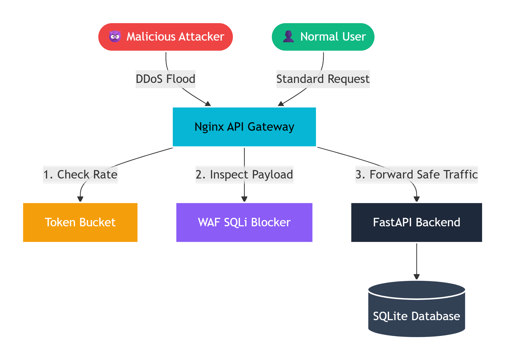
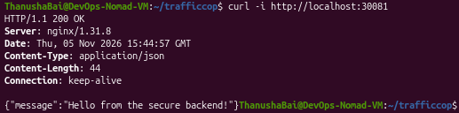
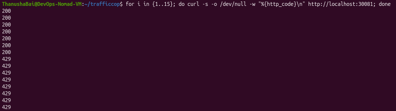
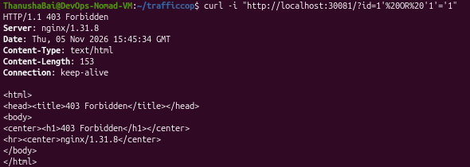
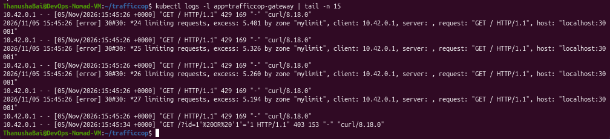

# 🚦 TrafficCop: Kubernetes API Gateway & DDoS Simulator

**Stop the bad traffic. Protect the backend.**

TrafficCop is a cloud-native API Gateway built to protect backend applications from DDoS attacks and malicious payloads. Built using Nginx, FastAPI, and Kubernetes (K3s), it sits at the edge of the network, enforcing rate limits and Web Application Firewall (WAF) rules before traffic ever reaches the internal application.

## 🚀 Key Features
- **Reverse Proxy Architecture:** The FastAPI backend is completely hidden from the public internet using a Kubernetes `ClusterIP` service. All external traffic must pass through the Nginx Gateway.
- **DDoS Mitigation (Rate Limiting):** Implemented Nginx's Token Bucket algorithm (`limit_req_zone`) to restrict IPs to 3 requests per second, returning `HTTP 429 Too Many Requests` during traffic floods.
- **Web Application Firewall (WAF):** Configured regex-based Nginx rules to instantly block SQL Injection payloads (e.g., `' OR 1=1 --`) with `HTTP 403 Forbidden`.
- **Production-Ready Containerization:** Both the Gateway and Backend are built as lightweight Docker images deployed to a lightweight K3s cluster.

## 🏗️ Architecture

---

## 📸 Proof of Concept (DDoS & WAF Drill)

Here is the step-by-step execution of normal traffic, a simulated DDoS attack, and a WAF block:

### 1. Normal Traffic (200 OK)
The user sends a standard request to the Gateway. The Gateway checks the rate limit, verifies the payload is safe, and proxies the request to the backend.

### 2. DDoS Attack Mitigated (429 Too Many Requests)
I sent 20 rapid requests to the Gateway. The burst limit allowed 6 requests, while the remaining 14 were instantly blocked with HTTP 429 to prevent backend exhaustion.

### 3. WAF Blocking SQL Injection (403 Forbidden)
I attempted to pass a malicious SQL payload (`?id=1' OR '1'='1`) to the backend. The Gateway's WAF regex instantly blocked it, returning a 403 Forbidden before it could reach the database.

### 4. Gateway Logs (Evidence of Block)
The Nginx Gateway logs prove the rate limiter and WAF are actively protecting the backend, showing the attacker's IP and the exact reason for the block.

---

## 🛠️ Tech Stack
**Gateway:** Nginx (Alpine)  
**Backend:** Python (FastAPI)  
**Orchestration:** Kubernetes (K3s)  
**Networking:** NodePort, ClusterIP, Reverse Proxy, WAF, Rate Limiting
